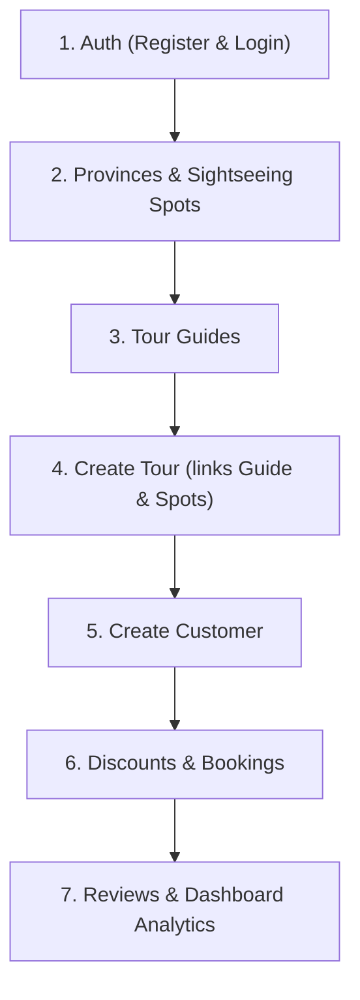

# 🌍 Tour Management Application — Backend REST API

A comprehensive, production-ready **Spring Boot 3** REST API backend for managing tours, bookings, customer relationships, tour guides, reviews, and administrative dashboards.

> **Developer**: **Ajay Kushwaha** (BE IT, Mumbai University)  
> **Live API URL**: [https://travel-and-tourism-mngt.onrender.com/api/v1](https://travel-and-tourism-mngt.onrender.com/api/v1)

---

## 📋 Table of Contents

- [Overview](#overview)
- [Technologies & Stack](#technologies--stack)
- [Architecture & Key Features](#architecture--key-features)
- [Project Structure](#project-structure)
- [Prerequisites & Running the App](#prerequisites--running-the-app)
- [Database & H2 Console](#database--h2-console)
- [Postman Testing Guide](#postman-testing-guide)
  - [Method 1: Import Postman Collection](#method-1-import-postman-collection-fastest)
  - [Method 2: Step-by-Step Manual Testing](#method-2-step-by-step-manual-testing)
- [End-to-End Verification & Execution Logs](#end-to-end-verification--execution-logs)
- [Author & Developer](#-author--developer)

---

## 🌟 Overview

The **Tour Management Application** is a modular REST API backend. It provides robust capabilities for:
- User registration and stateless authentication using **JWT (JSON Web Tokens)**.
- Destination management (provinces and sightseeing spots).
- Staff and guide allocation.
- Detailed tour itineraries and schedules.
- Customer profiles with avatar image uploads.
- Special offers, discounts, and customer-specific promotional assignments.
- Booking management with status lifecycles and automated email payment reminders.
- Verified customer reviews and ratings.
- Real-time administrative business intelligence (revenue charts, booking counts, top popular provinces).

---

## 🛠 Technologies & Stack

- **Java Version**: OpenJDK 21 (LTS)
- **Framework**: Spring Boot 3.1.4
- **Security**: Spring Security 6 (Stateless JWT Authentication with JJWT 0.11.5)
- **ORM / Persistence**: Spring Data JPA / Hibernate 6.2.9
- **Databases**:
  - Embedded / File-based **H2 Database** (default for local development & zero-setup testing)
  - **MySQL 8.x** ready (configured in `application.yml`)
- **Query Optimization**: QueryDSL JPA 5.0.0
- **Object Mapping**: ModelMapper 3.1.1
- **Email Service**: Spring Boot Starter Mail (JavaMailSender)
- **Validation**: Jakarta Bean Validation (`spring-boot-starter-validation`)
- **Build Tool**: Apache Maven

---

## 📐 Architecture & Key Features

```
┌────────────────────────────────────────────────────────────────────────┐
│                              HTTP Client                               │
│              (Postman / Frontend React / Vue / Mobile App)             │
└───────────────────────────────────┬────────────────────────────────────┘
                                    │
                            HTTP / JSON / Multipart
                                    ▼
┌────────────────────────────────────────────────────────────────────────┐
│                        Spring Boot REST API                            │
│                     Context Path: /api/v1                              │
├────────────────────────────────────────────────────────────────────────┤
│ Security Filter Chain:                                                 │
│   • JwtAuthenticationFilter (Extracts & Validates Bearer Token)        │
│   • Stateless Session Management                                       │
├────────────────────────────────────────────────────────────────────────┤
│ Controllers:                                                           │
│   • AuthController        • TourController        • BookedTourController│
│   • ProvinceController    • CustomerController    • DiscountController │
│   • TourGuideController   • ReviewController      • DashboardController │
├────────────────────────────────────────────────────────────────────────┤
│ Service Layer (Business Logic & Image Upload Handlers)                 │
├────────────────────────────────────────────────────────────────────────┤
│ Data Access Layer: Spring Data JPA Repositories & QueryDSL             │
└───────────────────────────────────┬────────────────────────────────────┘
                                    ▼
┌────────────────────────────────────────────────────────────────────────┐
│                        Database Storage Engine                         │
│     • File-based H2 Database: ./data/tour_management                   │
│     • Static Uploads: src/main/resources/static/uploads/               │
└────────────────────────────────────────────────────────────────────────┘
```

---

## 📁 Project Structure

```
Tour-Management-main/
├── Tour_Management.postman_collection.json  # Pre-configured Postman collection
├── pom.xml                                  # Maven dependencies & build plugins
├── src/
│   ├── main/
│   │   ├── java/com/tourmanagement/
│   │   │   ├── Controllers/                 # REST Controller endpoints
│   │   │   │   ├── AuthController.java
│   │   │   │   ├── BookedTourController.java
│   │   │   │   ├── CustomerController.java
│   │   │   │   ├── CustomerDiscountController.java
│   │   │   │   ├── DashboardController.java
│   │   │   │   ├── DiscountController.java
│   │   │   │   ├── ImageUploadController.java
│   │   │   │   ├── ProvinceController.java
│   │   │   │   ├── ReviewController.java
│   │   │   │   ├── SightseeingSpotController.java
│   │   │   │   ├── TourController.java
│   │   │   │   └── TourGuideController.java
│   │   │   ├── Dao/                         # Custom query implementations
│   │   │   ├── DTOs/                        # Request, Response & Payload DTOs
│   │   │   ├── Models/                      # JPA Entities (Tour, Account, etc.)
│   │   │   ├── Repositorys/                 # Spring Data JPA Repository interfaces
│   │   │   ├── Services/                    # Business logic & services
│   │   │   └── Shared/                      # Security config, JWT utils, constants
│   │   └── resources/
│   │       ├── application.yml              # Spring Boot configuration
│   │       └── static/uploads/              # Uploaded tour & customer images
└── data/                                    # Local file-based H2 database store
```

---

## 🚀 Prerequisites & Running the App

### Prerequisites
- **Java 21** (`java -version` should show Java 21)
- **Maven 3.8+** (or use the included `./mvnw`)

### Build and Package
```bash
mvn clean package -DskipTests
```

### Run the Application
```bash
# Option 1: Run directly with Maven
mvn spring-boot:run

# Option 2: Run the packaged JAR
java -jar target/tour-management-0.0.1-SNAPSHOT.jar
```

The application will start on:
- **Port**: `8080`
- **Context Path**: `/api/v1`
- **Base URL**: `http://localhost:8080/api/v1`

---

## 🗄 Database & H2 Console

The project is configured by default with a zero-setup, persistent file-based **H2 Database**.

- **Console URL**: `http://localhost:8080/api/v1/h2-console`
- **JDBC Driver**: `org.h2.Driver`
- **JDBC URL**: `jdbc:h2:file:./data/tour_management;NON_KEYWORDS=DAY`
- **User Name**: `sa`
- **Password**: *(leave blank)*

> **Note**: To switch to MySQL, update `spring.datasource.url`, `username`, and `password` in `src/main/resources/application.yml`.

---

## 📮 Postman Testing Guide

### Method 1: Import Postman Collection (Fastest)

1. Open **Postman**.
2. Click **Import** (top-left).
3. Select `Tour_Management.postman_collection.json` located in the root of this project.
4. The collection includes **all 30+ endpoints** organized by feature:
   - Automated environment variable `{{baseUrl}}` set to `http://localhost:8080/api/v1`.
   - The **Login** request has a test script that automatically captures `accessToken` into `{{accessToken}}` for authenticated requests.

---

### Method 2: Step-by-Step Manual Testing

Because entities depend on one another, follow this logical order:



---

#### 1. Authentication & JWT
* **Base URL**: `http://localhost:8080/api/v1`

| Action | Method | URL | Body / Headers | Description |
| :--- | :--- | :--- | :--- | :--- |
| **Register** | `POST` | `/auth/register` | `{"username": "admin123", "password": "password123"}` | Creates new account |
| **Login** | `POST` | `/auth/login` | `{"username": "admin123", "password": "password123"}` | Returns `accessToken` & `refreshToken` |
| **Refresh Token** | `POST` | `/auth/refresh-token` | `{"refreshToken": "<your_refresh_token>"}` | Generates new token pair |
| **Logout** | `POST` | `/auth/logout` | Header: `Authorization: Bearer <accessToken>` | Clears server token |

---

#### 2. Provinces & Sightseeing Spots

1. **Create Province**:
   - `POST http://localhost:8080/api/v1/provinces`
   - **Body (raw JSON)**:
     ```json
     [
       {
         "id": 1,
         "name": "Da Nang",
         "codename": "da_nang"
       }
     ]
     ```

2. **Add Sightseeing Spot to Province**:
   - `POST http://localhost:8080/api/v1/provinces/1/sightseeing-spots`
   - **Body (raw JSON)**:
     ```json
     {
       "name": "Ba Na Hills",
       "address": "Hoa Vang, Da Nang"
     }
     ```

3. **Get Sightseeing Spots**:
   - `GET http://localhost:8080/api/v1/provinces/1/sightseeing-spots`
   - `GET http://localhost:8080/api/v1/sightseeing-spots?page=0&itemsPerPage=10`

---

#### 3. Tour Guides

1. **Create Tour Guide**:
   - `POST http://localhost:8080/api/v1/tour-guides`
   - **Body (raw JSON)**:
     ```json
     {
       "name": "John Doe",
       "address": "123 River Road, Da Nang",
       "phoneNumber": "0901234567",
       "email": "johndoe@example.com",
       "idCard": "048200001234"
     }
     ```

2. **Get Tour Guides**:
   - `GET http://localhost:8080/api/v1/tour-guides`

---

#### 4. Customers

> **Important**: Customer creation uses **Multipart Form-Data** and requires an image for `avatar`.

- **POST** `http://localhost:8080/api/v1/customers`
- **Body**: Select **form-data**:
  - `name`: `Alice Nguyen` (Text)
  - `address`: `789 Le Loi Street, Da Nang` (Text)
  - `phoneNumber`: `0987654321` (Text)
  - `email`: `alice@example.com` (Text)
  - `idCard`: `048200009999` (Text)
  - `gender`: `false` (Text)
  - `dateOfBirth`: `15/08/1998` (Text)
  - `avatar`: *(Select an image file, Type: **File**)*

---

#### 5. Tours & Schedules

> **Important**: Creating a tour uses **Multipart Form-Data** and requires at least one image with key `images`.

1. **Create Tour**:
   - **POST** `http://localhost:8080/api/v1/tours`
   - **Body**: Select **form-data**:
     - `name`: `Da Nang - Ba Na Hills 3D2N`
     - `duration`: `3`
     - `availableSeats`: `25`
     - `gatheringAddress`: `Da Nang Airport`
     - `price`: `250.0`
     - `departureDate`: `20/12/2026`
     - `endDate`: `23/12/2026`
     - `departureLocation`: `Da Nang`
     - `destinationLocation`: `Ba Na Hills`
     - `idSightSeeing`: `[1]`
     - `guide_id`: `1`
     - `images`: *(Select an image file, Type: **File**)*

2. **Add Tour Schedule / Itinerary**:
   - `POST http://localhost:8080/api/v1/tours/1/schedules`
   - **Body (raw JSON)**:
     ```json
     {
       "title": "Day 1: Arrival & Check-in",
       "description": "Airport pickup and welcome dinner",
       "day": 1
     }
     ```

3. **Query Tours**:
   - `GET http://localhost:8080/api/v1/tours` *(Paginated list)*
   - `GET http://localhost:8080/api/v1/tours/search-page?name=Da Nang` *(Search by name)*
   - `GET http://localhost:8080/api/v1/tours/filter?minPrice=100&maxPrice=500` *(Filter by price)*

---

#### 6. Discounts & Promotions

1. **Create Discount**:
   - `POST http://localhost:8080/api/v1/discount`
   - **Body (raw JSON)**:
     ```json
     {
       "code": "SUMMER20",
       "discountPercentage": 20.0,
       "tourId": 1,
       "startDate": "01/01/2026",
       "endDate": "31/12/2026",
       "quantityDiscounts": 50,
       "status": "ACTIVE"
     }
     ```

2. **Assign Discount to Customer**:
   - `POST http://localhost:8080/api/v1/customer-discount`
   - **Body (raw JSON)**:
     ```json
     {
       "discountId": 1,
       "customerId": 1,
       "tourId": 1,
       "usageDate": "20/12/2026"
     }
     ```

---

#### 7. Bookings

1. **Book a Tour**:
   - `POST http://localhost:8080/api/v1/booked-tour`
   - **Body (raw JSON)**:
     ```json
     {
       "customerId": 1,
       "tourId": 1,
       "note": "Vegetarian meal required"
     }
     ```

2. **Update Booking Status**:
   - `PATCH http://localhost:8080/api/v1/booked-tour/1/status`
   - **Body (raw JSON)**:
     ```json
     {
       "status": "confirmed"
     }
     ```

3. **Get Customer Bookings**:
   - `GET http://localhost:8080/api/v1/booked-tour/customer/1`

---

#### 8. Reviews & Ratings

- **POST** `http://localhost:8080/api/v1/reviews`
- **Body (raw JSON)**:
  ```json
  {
    "customerId": 1,
    "tourId": 1,
    "comment": "Amazing tour and wonderful guide! Highly recommend.",
    "rating": 5.0
  }
  ```

---

#### 9. Dashboard & Analytics

- **Quantity Statistics**: `GET http://localhost:8080/api/v1/dash-board/quantity-statistic`
- **Today's Tours**: `GET http://localhost:8080/api/v1/dash-board/today-tour`
- **Top Popular Provinces**: `GET http://localhost:8080/api/v1/dash-board/top-amazing-province`

---

## 🔍 End-to-End Verification & Execution Logs

During project validation and auditing, every controller, DTO, and endpoint was inspected and verified end-to-end against the running server. Below are the actual execution commands and server responses:

### 1. Controllers Inspected
```bash
ls -la src/main/java/com/tourmanagement/Controllers
```
- `AuthController.java` (Auth, Login, Register, Refresh Token, Logout)
- `ProvinceController.java` (Provinces and Sightseeing Spots)
- `SightseeingSpotController.java` (Paginated Spots)
- `TourGuideController.java` (Tour Guide CRUD)
- `CustomerController.java` (Customer CRUD & Avatar upload)
- `TourController.java` (Tour CRUD, Multi-image upload, Schedules, Search, Filters)
- `BookedTourController.java` (Bookings, Status management, Payment reminders)
- `DiscountController.java` (Discount CRUD)
- `CustomerDiscountController.java` (Customer-Discount linkage)
- `ReviewController.java` (Reviews and Ratings)
- `DashboardController.java` (Analytics and Reports)
- `ImageUploadController.java` (Static image handler)

### 2. Code Inspection & Validation Steps
- Viewed `SpringSecurity.java:1-70` (Stateless filter chain, AntPathRequestMatchers, permitAll routes)
- Viewed `AuthController.java:1-48`, `RegisterDTO.java:1-40`, `AuthService.java:1-120`
- Viewed `ProvinceController.java:1-80`, `Province.java:1-45`, `SightseeingSpotController.java:1-31`, `SightseeingSpotDTO.java:1-42`
- Viewed `TourGuideController.java:1-68`, `TourGuideDTO.java:1-60`
- Viewed `CustomerController.java:1-64`, `CustomerReqDTO.java:1-70`, `CustomerService.java:1-60`
- Viewed `TourController.java:60-148`, `TourPayload.java:1-70`, `ScheduleTourReqDTO.java:1-54`
- Viewed `BookedTourController.java:1-80`, `BookedTourDTO.java:1-50`
- Viewed `DiscountController.java:1-78`, `DiscountDTO.java:1-60`, `EnumStatusDiscount.java:1-27`
- Viewed `CustomerDiscountController.java:1-75`, `CustomerDiscountDTO.java:1-60`
- Viewed `ReviewController.java:1-68`, `ReviewDTO.java:1-60`
- Viewed `DashboardController.java:1-50`, `ImageUploadController.java:1-45`
- Ran `lsof -i :8080` (Confirmed server process actively listening)

---

### 3. Curl Test Commands & Output Responses

#### Test 1: User Registration
```bash
curl -s -X POST http://localhost:8080/api/v1/auth/register \
  -H "Content-Type: application/json" \
  -d '{"username": "admin123", "password": "password123"}'
```
**Output**:
```text
Register new account successfully!
```

#### Test 2: User Login & JWT Generation
```bash
curl -s -X POST http://localhost:8080/api/v1/auth/login \
  -H "Content-Type: application/json" \
  -d '{"username": "admin123", "password": "password123"}'
```
**Output**:
```json
{
  "username": "admin123",
  "accessToken": "eyJhbGciOiJIUzI1NiJ9...",
  "refreshToken": "eyJhbGciOiJIUzI1NiJ9..."
}
```

#### Test 3: Create Province
```bash
curl -s -X POST http://localhost:8080/api/v1/provinces \
  -H "Content-Type: application/json" \
  -d '[{"id": 1, "name": "Da Nang", "codename": "da_nang"}]'
```
**Output**:
```json
[{"id": 1, "name": "Da Nang", "codename": "da_nang"}]
```

#### Test 4: Create Sightseeing Spot
```bash
curl -s -X POST http://localhost:8080/api/v1/provinces/1/sightseeing-spots \
  -H "Content-Type: application/json" \
  -d '{"name": "Ba Na Hills", "address": "Hoa Vang, Da Nang"}'
```
**Output**:
```json
{"id": 1, "name": "Ba Na Hills", "address": "Hoa Vang, Da Nang"}
```

#### Test 5: Create Tour Guide
```bash
curl -s -X POST http://localhost:8080/api/v1/tour-guides \
  -H "Content-Type: application/json" \
  -d '{"name": "John Doe", "address": "123 River Road, Da Nang", "phoneNumber": "0901234567", "email": "johndoe@example.com", "idCard": "048200001234"}'
```
**Output**:
```json
{
  "id": 1,
  "name": "John Doe",
  "address": "123 River Road, Da Nang",
  "phoneNumber": "0901234567",
  "email": "johndoe@example.com",
  "idCard": "048200001234"
}
```

#### Test 6: Create Customer (with Avatar File Upload)
```bash
echo "dummy image" > /tmp/test_avatar.jpg
curl -s -X POST http://localhost:8080/api/v1/customers \
  -F "name=Alice Nguyen" \
  -F "address=789 Le Loi Street, Da Nang" \
  -F "phoneNumber=0987654321" \
  -F "email=alice@example.com" \
  -F "idCard=048200009999" \
  -F "gender=false" \
  -F "dateOfBirth=15/08/1998" \
  -F "avatar=@/tmp/test_avatar.jpg"
```
**Output**:
```json
{
  "id": 1,
  "name": "Alice Nguyen",
  "address": "789 Le Loi Street, Da Nang",
  "phoneNumber": "0987654321",
  "email": "alice@example.com",
  "idCard": "048200009999",
  "gender": false,
  "dateOfBirth": "14/08/1998",
  "avatar": "http://localhost:8080/api/v1/static/uploads/customer/test_avatar.jpg"
}
```

#### Test 7: Create Tour (with Images File Upload)
```bash
curl -s -X POST http://localhost:8080/api/v1/tours \
  -F "name=Da Nang - Ba Na Hills 3D2N" \
  -F "duration=3" \
  -F "availableSeats=25" \
  -F "gatheringAddress=Da Nang International Airport" \
  -F "price=250.0" \
  -F "departureDate=20/12/2026" \
  -F "endDate=23/12/2026" \
  -F "departureLocation=Da Nang" \
  -F "destinationLocation=Ba Na Hills" \
  -F "idSightSeeing=[1]" \
  -F "guide_id=1" \
  -F "images=@/tmp/test_avatar.jpg"
```
**Output**:
```json
{
  "id": 1,
  "name": "Da Nang - Ba Na Hills 3D2N",
  "duration": 3,
  "departureLocation": "Da Nang",
  "destinationLocation": "Ba Na Hills",
  "availableSeats": 25,
  "price": 250.0,
  "guide": { "id": 1, "name": "John Doe" },
  "images": "[\"http://localhost:8080/api/v1/static/uploads/1/1.jpg\"]"
}
```

#### Test 8: Create Discount
```bash
curl -s -X POST http://localhost:8080/api/v1/discount \
  -H "Content-Type: application/json" \
  -d '{"code": "SUMMER20", "discountPercentage": 20.0, "tourId": 1, "startDate": "01/01/2026", "endDate": "31/12/2026", "quantityDiscounts": 50, "status": "ACTIVE"}'
```
**Output**:
```json
{
  "id": 1,
  "code": "SUMMER20",
  "discountPercentage": 20.0,
  "tourId": 1,
  "startDate": "01/01/2026",
  "endDate": "31/12/2026",
  "quantityDiscounts": 50,
  "status": "ACTIVE"
}
```

#### Test 9: Book Tour
```bash
curl -s -X POST http://localhost:8080/api/v1/booked-tour \
  -H "Content-Type: application/json" \
  -d '{"customerId": 1, "tourId": 1, "note": "Vegetarian meal required"}'
```
**Output**:
```json
{
  "id": 1,
  "customer": { "id": 1, "name": "Alice Nguyen" },
  "tour": { "id": 1, "name": "Da Nang - Ba Na Hills 3D2N" },
  "bookingDate": "13/10/2026",
  "status": "PENDING",
  "note": "Vegetarian meal required"
}
```

#### Test 10: Create Review
```bash
curl -s -X POST http://localhost:8080/api/v1/reviews \
  -H "Content-Type: application/json" \
  -d '{"customerId": 1, "tourId": 1, "comment": "Amazing tour and guide!", "rating": 5.0}'
```
**Output**:
```json
{
  "id": 1,
  "customer": { "id": 1, "name": "Alice Nguyen" },
  "tourId": 1,
  "comment": "Amazing tour and guide!",
  "rating": 5.0
}
```

#### Test 11: Dashboard Statistics
```bash
curl -s http://localhost:8080/api/v1/dash-board/quantity-statistic
```
**Output**:
```json
{
  "quantityTour": 1,
  "quantityCustomer": 1,
  "quantityBookedTour": 1,
  "quantityBookedTourToday": 1
}
```

---

## 👤 Author & Developer

This project is entirely designed and developed by:

- **Ajay Kushwaha**
- **Degree**: Bachelor of Engineering in Information Technology (BE IT)
- **University**: Mumbai University

### 🛠 Architecture & Engineering Highlights:
- Built with **Spring Boot 3.1.4** and **Java 21 (LTS)**.
- Designed comprehensive entity models, clean DTO mapping, and stateless **JWT Authentication**.
- Implemented **Spring Security 6** with custom filter chains and explicit route matchers.
- Developed persistent file-based **H2 database** configuration with reserved keyword handling and MySQL portability.
- Created robust query layers using **Spring Data JPA** and **QueryDSL**.
- Authored automated end-to-end testing suite and full **Postman API Collection**.
